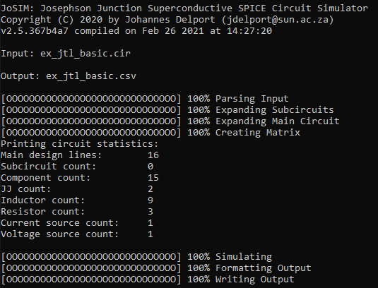
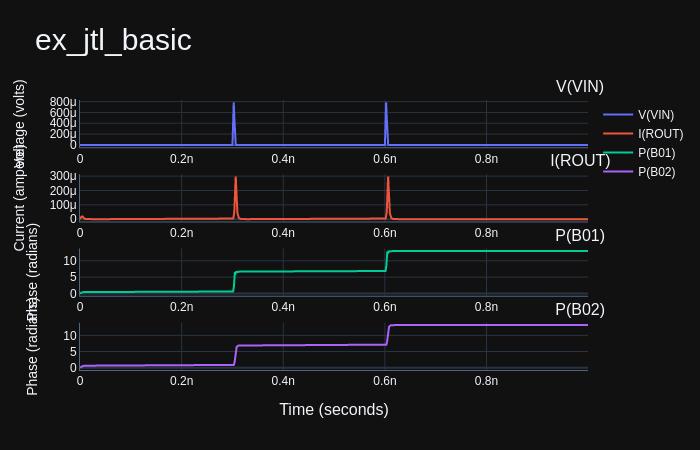

# Example Usage

## Basic JTL Example

In this section we provide example usage for JoSIM. In the [*test*](https://github.com/JoeyDelp/JoSIM/tree/master/test) subfolder of the repository the user will find multiple example files that can be used to test JoSIM with.

In this example we will make use of the[ *ex_jtl_basic.cir*](https://github.com/JoeyDelp/JoSIM/tree/master/test/ex_jtl_basic.cir) file. This is a basic Josephson transmission line (JTL) that transmits two single-flux-quantum input pulses through two junctions.

Save the self-contained circuit below as `ex_jtl_basic.cir`. The repository
example also contains model `.iv` generation, omitted here; see the
[sweep guide](sweeps.md) for that separate operation.

~~~
* Example JTL Basic
B01        3          7          jmod     area=2.16
B02        6          8          jmod     area=2.16
IB01       0          1          pwl(0      0 5p 280u)
L01        4          3          2p        
L02        3          2          2.425p    
L03        2          6          2.425p    
L04        6          5          2.031p    
LP01       0          7          0.086p    
LP02       0          8          0.096p    
LPR01      2          1          0.278p    
LRB01      7          9          0.086p    
LRB02      8          10         0.086p    
RB01       9          3          5.23      
RB02       10         6          5.23      
ROUT       5          0          2         
VIN        4          0          pwl(0 0 300p 0 302.5p 827.13u 305p 0 600p 0 602.5p 827.13u 605p 0)
.model jmod jj(rtype=1, vg=2.8mV, cap=0.07pF, r0=160, rN=16, icrit=0.1mA)
.tran 0.25p 1000p 0 0.25p
.print DEVV VIN
.print DEVI ROUT
.print PHASE B01
.print PHASE B02
.end
~~~


Only the device voltage (DEVV) of the input source (VIN), the device current (DEVI) of the output resistor (ROUT) and the phase of both junctions are requested to be output.

The simulation executes for a total of 1000ps and produces a result every 0.25ps which results in 4000 points of data for each requested variable.

From the directory containing this circuit, run an extracted or installed CLI:

````bash
josim-cli -o ./ex_jtl_basic.csv ./ex_jtl_basic.cir -V 1
````

Runtime depends on the build and host. `-V 1` reports the effective internal grid. The terminal image below is an illustration from an earlier version.

<center></center>


The results of this simulation are stored in the *ex_jtl_basic.csv* file with the following excerpt from the 3.0.0 phase-mode run. Intermediate rows are omitted; last-bit values can vary with toolchain.

```csv
time,"V(VIN)","I(ROUT)","P(B01)","P(B02)"
0.000000e+00,0.000000e+00,0.000000e+00,0.000000e+00,0.000000e+00
2.500000e-13,0.000000e+00,6.636509e-07,2.899951e-03,2.923977e-03
5.000000e-13,0.000000e+00,1.963239e-06,1.130820e-02,1.150191e-02
7.500000e-13,0.000000e+00,3.931372e-06,2.615879e-02,2.691635e-02
1.000000e-12,0.000000e+00,6.352259e-06,4.650288e-02,4.856039e-02
...
9.992500e-10,1.753829e-18,1.753829e-18,1.297098e+01,1.318194e+01
9.995000e-10,1.753829e-18,1.753829e-18,1.297098e+01,1.318194e+01
9.997500e-10,1.753829e-18,1.753829e-18,1.297098e+01,1.318194e+01
```

We then plot this result with `scripts/josim-plot.py`. Install its isolated
environment using the [Python utility guide](python_utilities.md), then run:

```
build/python-utilities/bin/python scripts/josim-plot.py ./ex_jtl_basic.csv -t stacked
```

This produces the following visualized result:

<center></center>


Through the representation of the results visually, the user can see the two SFQ pulses at the input and through the output resistor, including the phases of the two junctions.

The same process can be done for every example found in the *test* folder on the repository.
