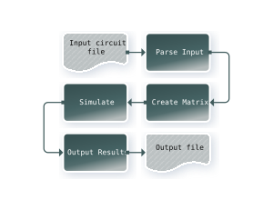

# JoSIM - Superconducting Circuit Simulator

User and developer documentation for the current source tree. For published
binaries, see [GitHub Releases](https://github.com/JoeyDelp/JoSIM/releases).
Fixes and compatibility changes are recorded in the
[changelog](https://github.com/JoeyDelp/JoSIM/blob/master/CHANGELOG.md).

The 3.0.0 source line includes the completed branch consolidation and audit
repairs. Read [compatibility and migration](compatibility.md) before reusing
older results or C++ applications. JoSIM remains freely available under MIT;
it is the open-source predecessor of JoSIM-Pro.

## Introduction

JoSIM was developed under IARPA contract SuperTools(via the U.S. Army Research Office grant W911NF-17-1-0120). JoSIM is a analogue circuit simulator with SPICE syntax input that has inherent support for the superconducting Josephson junction element.

JoSIM is meant to function as an alternative to the simulators such as JSIM[^1] and WRspice[^2]. JoSIM is written in modern C++ and is fully customizable and extendable to offer support for improved superconducting elements as well better approximations to the Josephson effect in superconducting materials.

A *.cir* file containing a SPICE syntax circuit netlist is provided as input. The circuit netlist, given appropriate input excitations can then be simulated through transient analysis. Results of this simulation can be dumped to standard output or saved in various formats such as a comma separated value (*.csv*) file.

Below is a macro overview of the process performed by JoSIM. This is very basic and is discussed in further detail in the [Technical Discussion](tech_disc.md) section of the documentation.

<center></center>


## Project layout

The JoSIM repository has the following layout. A quick description shows the purpose of the various files and folders.

    cmake   			# CMake scripts.
    docs/
        index.md		# The documentation homepage.
        ...      		# Other markdown pages, images and other files.
    include/
        JoSIM			# JoSIM header files.
    scripts				# Some Python3 scripts to automate testing and plotting
    tools				# Build, qualification, sweep and documentation owners.
    build/				# Generated builds and documentation (ignored).
    artifacts/			# Local qualification results (ignored).
    src/
        ...				# JoSIM source files.
    test				# Folder containing various examples.
    README.md			# Basic readme to get the user going.
    LICENSE				# License that governs use of JoSIM.
    CMakeLists.txt		# Configuration to compile code.
    ...					# Other configuration files and scripts.

## Getting started

Download and extract the archive for your operating system and architecture from
[GitHub Releases](https://github.com/JoeyDelp/JoSIM/releases). The executable is
in `bin/`. Add that directory to your `PATH`, or invoke the executable by its
full path. The archive includes the C++ library and headers.

For example, from the repository root with a local build:

```bash
build/dev/josim-cli -o build/example.csv test/ex_dcsfq_jtl_sink.cir
```

On multi-configuration Windows builds the executable is under
`build/dev/Release/`. See [Example Usage](ex_usage.md) and the
[Syntax Guide](syntax.md) for netlists, analysis modes and output options.

To compile and test from source, follow [Developing JoSIM](DEVELOPMENT.md).
The [release procedure](RELEASE_POLICY.md) describes binary targets, runtime
baselines and package verification.

Current source additions have separate guides:

- [Gate-controlled junctions](gate_junctions.md)
- [Noise sources](noise_sources.md)

#### TimeEx and other tools

Some tools, such as TimEx, require *josim-cli* to be named *josim*. Since the josim command line executable (*josim-cli*) is a singular executable, this means that there are no files that rely on its specific naming for JoSIM to function correctly. It can thus safely be renamed or copies made thereof with varying names as required by external tools (such as TimEx).

Under Unix systems a symbolic link can be established through:

```bash
sudo ln -s /usr/local/bin/josim-cli /usr/local/bin/josim
```

Where the first path is the source and the second is the destination. If *josim-cli* is updated *josim* will reflect this since the symbolic link simply makes *josim-cli* obtainable through another name.

On Windows it is best to simply rename *josim-cli* or to make a copy thereof with a new name.

### License

JoSIM is governed by the MIT license, which is a very permissive license that allows anyone to redistribute the source as well as commercialize it without repercussions. The MIT license allows use of this software within proprietary software as long as all copies of the licensed software includes a copy of the MIT license as well as the copyright notice.

[^1]: E. S. Fang and T. Van Duzer, "A Josephson integrated circuit simulator (JSIM) for superconductive electronics application," in *Extended Abstracts of 1989 Intl. Superconductivity Electronics Conf. (ISEC '89)*, Tokyo, Japan: JSAP, pp. 407-410, 1989
[^2]: S. R. Whiteley, "WRspice Circuit Simulator" by *Whiteley Research Incorporated*. http://www.wrcad.com/wrspice.html
