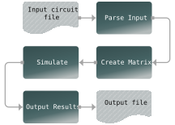

# JoSIM - 超伝導回路シミュレータ

現在のソース（3.0.0 系）のユーザー・開発者向け文書です。
公開済みバイナリは [GitHub Releases](https://github.com/JoeyDelp/JoSIM/releases)、
変更点は [CHANGELOG](https://github.com/JoeyDelp/JoSIM/blob/master/CHANGELOG.md) を参照してください。

日本語版は要点を更新しています。新しいモデル・検証条件の詳細は
[英語版](../index.md) と [互換性・移行ガイド](../compatibility.md) を参照してください。

## はじめに

JoSIMはIARPA（助成金：U.S. Army Research Office grant W911NF-17-1-0120）のSuperToolsの下で開発されました。

JoSIMはアナログ回路シミュレータであり、超伝導素子であるJosephson junctionを表現できる性質を持った、SPICEという文法を用いています。

JoSIMはJSIM[^1]やWRspice[^2]のようなシミュレータの代わりの役割を果たすことを意図して作られました。JoSIMはモダンなC++で書かれており、新しい超電導素子の助けになるように、そして超電導素材のJosephson効果に対する良い近似になるよう幅広いカスタマイズ性・拡張性を持たせています。

SPICE文法による回路のネットリストを表す*.cir*ファイルを入力すると、ネットリストをトランジェント解析することが出来ます。
シミュレーション結果は標準出力へのダンプ、もしくは*.csv*ファイルとしての出力が可能です。

以下がざっくりとしたJoSIMによる処理過程です。これは非常に基礎的なものであり詳細についてはドキュメントの[技術的な議論](tech_disc_jp.md) のセクションで示します。


<center></center>


## ファイル構成

JoSIMリポジトリは次のような構成になっています。ファイルとフォルダの目的を簡単に示します。


    cmake   			# CMakeスクリプト。
    docs/
        index.md		# ドキュメンテーションのホームページ。
        ...      		# その他のマークダウンページ、画像・その他のファイル。
    include/
        JoSIM			# JoSIMのヘッダファイル。
    scripts				# テスト自動化とグラフ描画のためのPython3スクリプト。
    site				# このドキュメンテーションが生成される場所。
    src/
        ...				# JoSIMのソースファイル。
    test				# 様々なサンプルが入っているフォルダ。
    README.md			# ユーザに始めてもらうための基本的なreadme。
    LICENSE				# JoSIMの利用に適用されるライセンスについて。
    CMakeLists.txt		# コードをコンパイルするためのコンフィグ。
    ...					# その他のコンフィグファイルとスクリプト。

## 初期セットアップ

[Releases](https://github.com/JoeyDelp/JoSIM/releases) から OS と CPU に対応する
アーカイブを展開し、`bin/` 内の実行ファイルを使用します。対象は Linux x86_64・
AArch64、Windows x64、macOS arm64・Intel です。最低実行環境と実際の検証範囲は
[リリース手順](../RELEASE_POLICY.md) を参照してください。

### ソースからのビルド

C++17、C11、CMake/CTest 3.21 以上、Python 3 が必要です。リポジトリのルートで実行します。
依存ソルバーはハッシュを検証して取得されます。KLU のみをサポートします。

```bash
cmake -S . -B build/dev -DCMAKE_BUILD_TYPE=Release
cmake --build build/dev --config Release --parallel 4
ctest --test-dir build/dev -C Release --output-on-failure --timeout 90
build/dev/josim-cli -o build/example.csv test/ex_dcsfq_jtl_sink.cir
```

Windows の複数構成ジェネレーターでは `build/dev/Release/josim-cli.exe` を使用します。
オフライン準備、共有ライブラリ、インストール済みライブラリの利用は
[開発手順](../DEVELOPMENT.md) と [C++ API](../API.md) を参照してください。
既存 C++ アプリケーションは同じ版のヘッダーとライブラリで再コンパイルしてください。
`SLU=ON`、`USING_OPENMP=ON`、CLI `-x`・`-p` は非対応としてエラーになります。

#### TimExとその他のツール

TimExのようないくつかのツールでは*josim-cli* を*josim*という名前にする必要があります。josimコマンドラインツール(*josim-cli*)は単体で実行可能なので、正しく機能するために特定のJoSIMの名前に依存しているファイルなどはどこにもないことになります。すなわち安全に名前を変えたり（TimExのような）外部ツールで必要な色々な名前の複製を作ったりすることが可能です。

Unixシステムでは以下のようにシンボリックリンクを作ることができます：

```bash
sudo ln -s /usr/local/bin/josim-cli /usr/local/bin/josim
```

ここで最初のパスはソースで、二番目は指し示している先を表しています。シンボリックリンクは単純に他の名前で*josim-cli* を取得可能にしているだけなので、もし*josim-cli*がアップデートされた場合でも、*josim*はその変更を反映しています。

Windowsの場合は単純に*josim-cli*をリネームするかコピーして新しい名前をつけるのが一番いいです。

### License
JoSIMにはMITライセンスが適用されており、これは誰でもソースの再配布が可能・無償利用可能という非常に寛容なライセンスです。MITライセンスでは、MITライセンスと著作権表示がコピーされたソフトウェアに含まれている限りは所有の範囲内での利用を認めています。


[^1]: E. S. Fang and T. Van Duzer, "A Josephson integrated circuit simulator (JSIM) for superconductive electronics application," in *Extended Abstracts of 1989 Intl. Superconductivity Electronics Conf. (ISEC '89)*, Tokyo, Japan: JSAP, pp. 407-410, 1989
[^2]: S. R. Whiteley, "WRspice Circuit Simulator" by *Whiteley Research Incorporated*. http://www.wrcad.com/wrspice.html